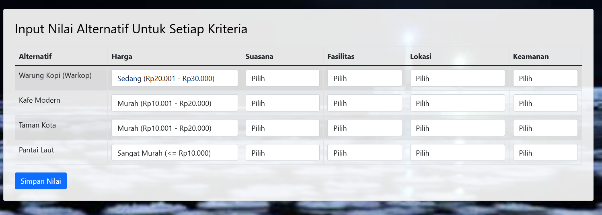
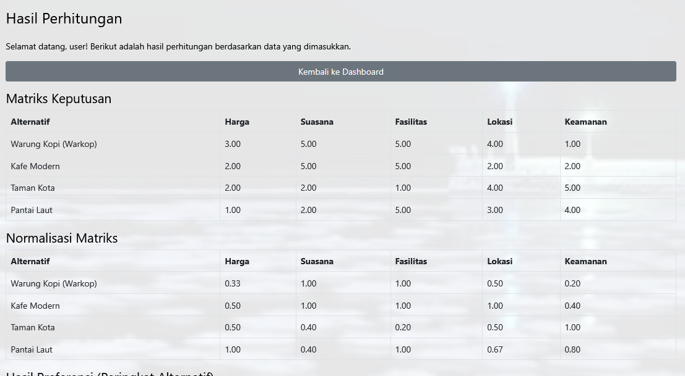
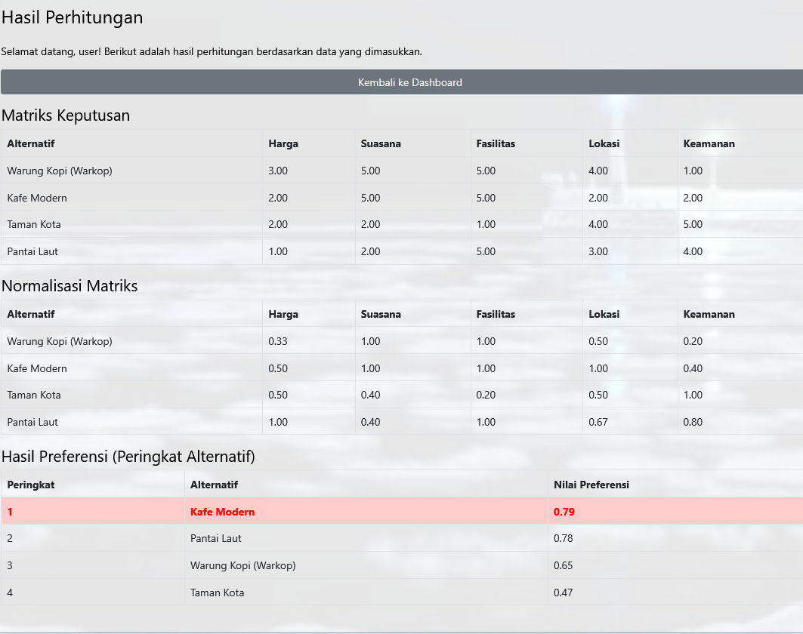

# ☕ Sistem Pendukung Keputusan (SPK) Rekomendasi Tempat Nongkrong Menggunakan Metode SAW

## 📌 Deskripsi Proyek
Sebuah aplikasi Sistem Pendukung Keputusan (SPK) berbasis web yang dirancang untuk membantu pengguna menentukan rekomendasi tempat nongkrong (cafe/resto) terbaik di wilayah Bireuen dan sekitarnya berdasarkan kriteria tertentu. Proyek ini dikembangkan pada Semester 5 sebagai pemenuhan tugas besar mata kuliah Sistem Pendukung Keputusan.

Sistem ini menerapkan **Metode SAW (Simple Additive Weighting)** untuk melakukan perhitungan matematis secara objektif. Proses analisis dilakukan dengan mencari penjumlahan terbobot dari rating kinerja pada setiap alternatif di semua kriteria yang telah ditentukan.

> ⚠️ **DISCLAIMER / CATATAN DATA:**  
> Seluruh data nama cafe, lokasi, dan fasilitas yang digunakan di dalam proyek ini digunakan murni sebagai data simulasi akademis (*dummy data*) untuk keperluan ilustrasi dan pengujian fungsi perhitungan algoritma sistem dalam lingkup pendidikan, serta **TIDAK** digunakan untuk tujuan komersial.

## 🎯 Fitur Utama
- **Manajemen Kriteria & Atribut**: Mendukung pengaturan kriteria berdasarkan tipe *Benefit* (keuntungan, misal: fasilitas) dan *Cost* (biaya, misal: harga).
- **Input Kriteria & Bobot**: Pengguna atau admin dapat menentukan bobot kepentingan untuk setiap kriteria (misal: mengutamakan harga murah atau fasilitas Wi-Fi).
- **Manajemen Alternatif Cafe**: Fitur untuk mengelola daftar tempat nongkrong yang akan dinilai oleh sistem.
- **Proses Normalisasi Matriks**: Menampilkan transparansi langkah-langkah perhitungan algoritma SAW mulai dari pembentukan matriks keputusan hingga matriks ternormalisasi ($R$).
- **Perankingan Otomatis**: Menghasilkan rekomendasi tempat nongkrong terbaik yang diurutkan berdasarkan nilai preferensi ($V$) tertinggi.

## 🛠️ Tech Stack & Algoritma
- **Algoritma SPK**: Simple Additive Weighting (SAW)
- **Backend**: PHP 
- **Frontend**: HTML5, CSS3, JavaScript, Bootstrap
- **Database**: MySQL

## 📸 Screenshot Sistem
### Halaman Utama & Input Bobot Kriteria

### Proses Perhitungan Algoritma SPK

### Hasil Akhir & Rekomendasi Ranking

## 👤 Developer
**Sri Ramadhani**  
S1 Informatika
📧 sriramadani596@gmail.com
